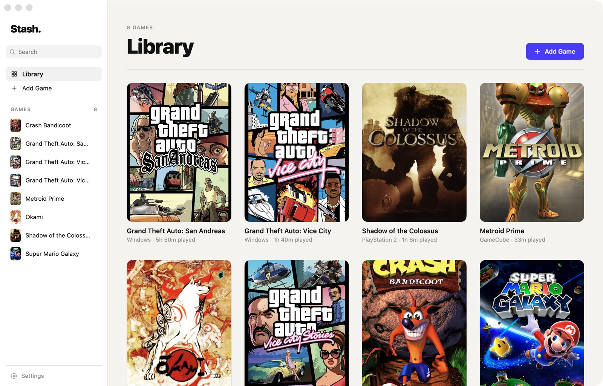
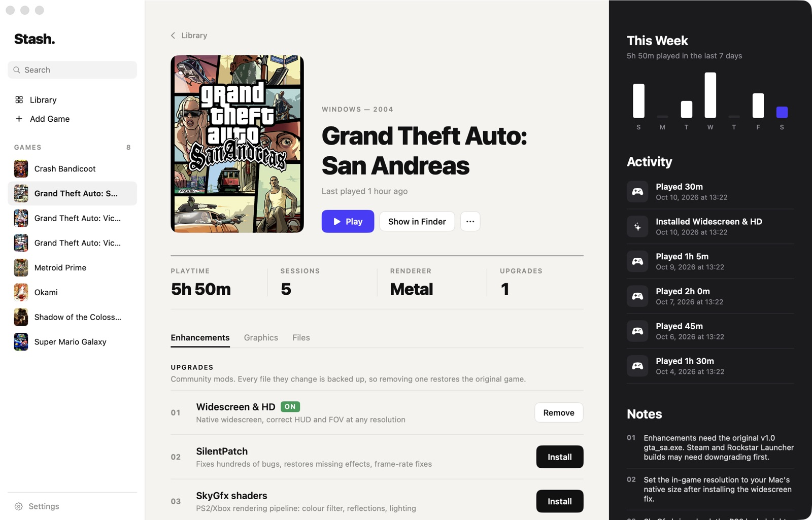
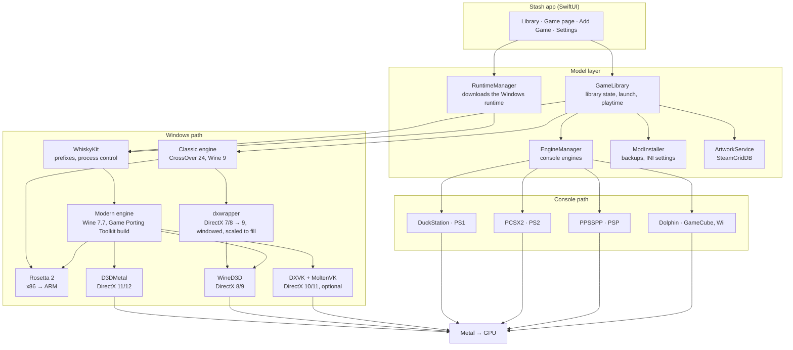
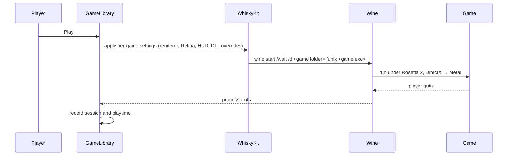
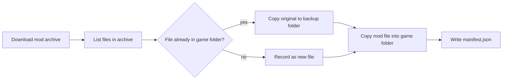

# Stash

A macOS launcher for Windows and console games on Apple Silicon.

Add a game from an installer, a disc image, a folder or a console game file, and Stash sets up everything it needs to run: a private Windows environment, the right graphics path to Metal, and optional upgrades like widescreen fixes. Games show up in one library with cover art, playtime and a Play button.





## Features

- **Windows games.** Runs `.exe` and `.msi` games through Wine and Apple's Game Porting Toolkit. Each game gets its own Windows environment, so games can't break each other.
- **Classic games.** 32-bit DirectX 7, 8 and 9 games from the 2000s are detected automatically and run on a second engine, CrossOver 24, with full-screen scaling. The game keeps its original resolution and is scaled to fill the display, so it never has to switch the Mac's screen mode.
- **Console games.** PlayStation, PlayStation 2, PSP, GameCube and Wii games boot straight into fullscreen. The platform is detected from the disc header.
- **Graphics.** DirectX 8–12 is translated to Metal. Per-game Retina rendering, a performance HUD, and 1×–6× internal resolution for console games.
- **One-click upgrades** for GTA III, Vice City and San Andreas: widescreen and HUD fixes with SMAA, SilentPatch, and SkyGfx. Every file a mod overwrites is backed up, so removing it restores the original game.
- **Cover art** from SteamGridDB, fetched automatically when a game is added.
- **Mac apps.** Any game can be exported as a `.app` for Launchpad, the Dock or Spotlight.
- **Playtime tracking** with a weekly chart and session history.
- **Clean uninstall.** One confirmation moves the game, its saves and settings, and any Mac app made for it to the Trash. Games and installers can't scatter shortcuts across your Mac, and a crashing game closes instead of leaving Wine error windows behind.

## Requirements

- A Mac with Apple Silicon (M1 or later)
- macOS 14 Sonoma or later
- Rosetta 2 (Stash offers to install it)
- About 250 MB for the Windows runtime, downloaded on first launch

## Install

Download `Stash.zip` from the [latest release](../../releases/latest), unzip it and move `Stash.app` to Applications.

Stash is not notarized yet, so macOS blocks the first launch. Right-click the app and choose **Open**, or run:

```sh
xattr -dr com.apple.quarantine /Applications/Stash.app
```

## Build from source

Requires Xcode 16 or later.

```sh
git clone https://github.com/shivvyas2/Stash.git
cd Stash
open Stash.xcodeproj
```

Press ⌘R. The Xcode project is generated from `project.yml` with [XcodeGen](https://github.com/yonaskolb/XcodeGen); run `xcodegen generate` after adding or removing source files.

## How it works

### Architecture



### Launching a Windows game



`start /wait` keeps the process attached until the game exits, which is how playtime is measured. Mods that replace a system DLL, like the `d3d8.dll` ASI loader in the Vice City widescreen fix, are loaded through `WINEDLLOVERRIDES`.

### Classic games

Stash reads a game's executable when it's added. A 32-bit game that imports `ddraw.dll`, `d3d8.dll` or `d3d9.dll` is marked as classic. The first time it's played, Stash:

1. Downloads the classic engine once (CrossOver 24.0.7, built by the Sikarugir project, about 260 MB).
2. Upgrades the game's Windows environment to that engine.
3. Installs [dxwrapper](https://github.com/elishacloud/dxwrapper) next to the game, set to run it in a window that is stretched to fill the display. DirectX 7 and 8 are converted to DirectX 9 on the way.

Two problems made this necessary. Games from this era switch the screen to resolutions like 640×480, which Mac displays don't offer, and crash when the switch fails. And the Wine 7.7 base of the Game Porting Toolkit build crashes some 32-bit games when they start audio. D3DMetal only covers DirectX 11 and 12, so these games lose nothing on the classic engine.

The engine can be changed per game under **Graphics**. A game that has run on the classic engine can't switch back, because its environment has been upgraded.

### Launching a console game

Console engines are open-source emulators that Stash downloads on first use into `~/Library/Application Support/Stash/Engines` and drives from the command line. The engine's own interface stays hidden: the game starts fullscreen in batch mode, and quitting the game returns to Stash.

| Platform | Engine | How Stash starts it |
|---|---|---|
| PlayStation | DuckStation | `-batch -nogui -fullscreen`, resolution and widescreen written to `settings.ini` |
| PlayStation 2 | PCSX2 | `-batch -nogui -fullscreen -gamecfg <per-game ini>` |
| PSP | PPSSPP | `--fullscreen --appendconfig=<per-game ini>` |
| GameCube, Wii | Dolphin | `-b -v Metal -C GFX.Settings.InternalResolution=<n>` |

PlayStation and PlayStation 2 games need a BIOS dumped from your own console. Stash can't include it.

### Installing an upgrade



Removing an upgrade reads the manifest, deletes the files the mod added and restores the backups. Some mods also need an original file kept under a new name first (San Andreas' `vorbisFile.dll` becomes `vorbisHooked.dll`); that is declared per mod in `Catalog.swift`.

## Project layout

```
Stash/
  StashApp.swift            app entry, URL handling (stash://play/<id>, stash://open/<id>)
  Model/
    Game.swift              game record, platforms, graphics modes
    GameLibrary.swift       library state, environments, launching, Mac app export
    RuntimeManager.swift    Windows runtime download and install
    ConsoleEngines.swift    console engine download, configuration and launch
    ClassicEngine.swift     classic engine install, prefix upgrade and launch
    ModInstaller.swift      mod install/uninstall with backups, INI editing
    Catalog.swift           recognised games and their upgrades
    ArtworkService.swift    SteamGridDB client, API key in the Keychain
    Support.swift           paths and small helpers
  Views/                    SwiftUI views and the design system (Theme.swift)
WhiskyKit/                  Wine prefix and process management (from Whisky)
project.yml                 XcodeGen project definition
```

## Where Stash keeps data

| What | Location |
|---|---|
| Library, covers, mod backups, classic and console engines | `~/Library/Application Support/Stash` |
| Windows runtime (Wine, D3DMetal, DXVK) | `~/Library/Application Support/app.stash.Stash/Libraries` |
| Game environments | `~/Games` by default, chosen per game |
| Wine logs | `~/Library/Logs/app.stash.Stash` |
| SteamGridDB API key | macOS Keychain |

## Built on

Stash started as a fork of [Whisky](https://github.com/Whisky-App/Whisky), which is no longer maintained. The Whisky app was replaced entirely; its `WhiskyKit` package still handles Wine prefixes and processes, with changes to install the runtime from new sources.

- [Wine](https://www.winehq.org) and CodeWeavers' CrossOver sources
- Apple's [Game Porting Toolkit](https://developer.apple.com/games/game-porting-toolkit/) (D3DMetal), using the builds published by [Gcenx](https://github.com/Gcenx/game-porting-toolkit)
- The classic engine: CrossOver 24.0.7 built by [Sikarugir](https://github.com/Sikarugir-App/Engines)
- [dxwrapper](https://github.com/elishacloud/dxwrapper) by elishacloud
- [DXVK-macOS](https://github.com/Gcenx/DXVK-macOS) and [MoltenVK](https://github.com/KhronosGroup/MoltenVK)
- [DuckStation](https://github.com/stenzek/duckstation), [PCSX2](https://github.com/PCSX2/pcsx2), [PPSSPP](https://github.com/hrydgard/ppsspp) and [Dolphin](https://dolphin-emu.org)
- [Widescreen Fixes Pack](https://github.com/ThirteenAG/WidescreenFixesPack) by ThirteenAG, [SilentPatch](https://github.com/CookiePLMonster/SilentPatch) by CookiePLMonster, [SkyGfx](https://github.com/aap/skygfx) by aap
- Cover art from [SteamGridDB](https://www.steamgriddb.com)

## Legal

Stash doesn't include or download any games or console BIOS files. Use it with games you own. Stash is not affiliated with Apple, Microsoft, Sony, Nintendo, Rockstar Games or any of the projects above.

## License

[GPL-3.0](LICENSE), the same license as Whisky.
